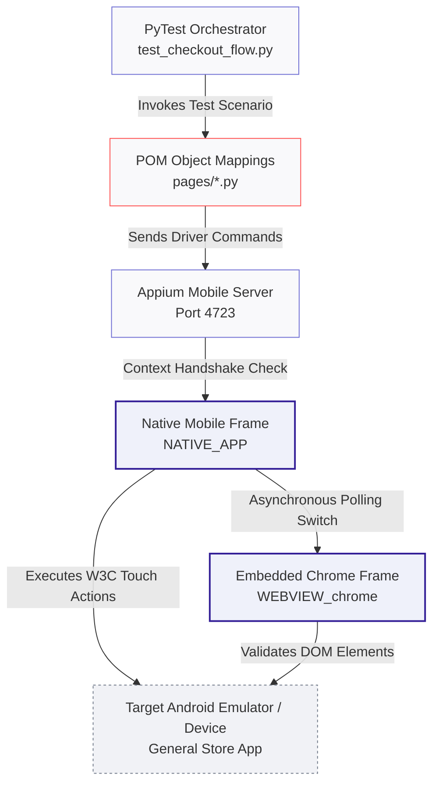

# 📱 Mobile Hybrid E-Commerce Test Automation Framework

[](https://github.com)
[](https://appium.io)
[](https://pytest.org)

---

## 🎯 About The Project
This framework is a production-grade mobile automation suite built from scratch using **Python**, **Appium (UiAutomator2)**, and **PyTest** using the **Page Object Model (POM)** design pattern. 

It validates complex end-to-end user lifecycles within hybrid Android web-view container environments (specifically evaluated against the `General Store` application package). The design addresses asynchronous context boundaries, W3C hardware gesture overrides, price string parsing transformations, and fail-safe automation session telemetry captures.

### 🛠️ Key Architectural Solutions Implemented
* **Asynchronous Context Switching:** Custom polling loops designed to cleanly handle execution handshakes between the `NATIVE_APP` driver root and embedded `WEBVIEW` contexts without breaking runtime sync states.
* **Dynamic Price Sum Assertions:** Regex metadata engines that scrape currency text fields, filter non-numeric symbols, cast raw strings into `float` variables, and execute mathematical summation verifications against target values.
* **Context-Aware Exception Triaging:** PyTest session hook monitors that catch runtime test execution breaks, force driver hooks safely back into native UI views, and dump visual framebuffers directly into report dashboards.
* **W3C Actions & Mobile Gestures:** Advanced custom touch simulations leveraging standard `ActionChains`, `PointerInput`, and `ActionBuilder` APIs to execute precise long-press triggers, vertical scroll movements, and pinch-to-zoom workflows.

---

## 🕹️ Interactive Navigation
* [🏗️ Hybrid E-Commerce Runner Architecture](#-hybrid-e-commerce-runner-architecture)
* [📋 Framework Component Matrix](#-framework-component-matrix)
* [📂 Directory Blueprint](#-directory-blueprint)
* [🚀 Quick Execution Guide](#-quick-execution-guide)

---

## 🏗️ Hybrid E-Commerce Runner Architecture



---

## 📋 Framework Component Matrix

| Component Module | Architecture Target Layer | Core Automation Functional Objective |
| :--- | :--- | :--- |
| **PyTest Engine** | Core Framework Orchestrator | Directs automated test runs, dynamically links operational configs, and builds report artifacts. |
| **Page Objects (POM)** | Interface Encapsulation Layer | Maps resource locators (IDs, Accessibility tags, CSS selectors) and isolates UI operations. |
| **Asynchronous Polling Engine** | Context Transition Bridge | Loops over active system handles until target frames exist to safely bridge native-to-web transitions. |
| **Price Parser Engine** | Data Transformation Node | Cleans text data blocks, converts raw numeric strings to floats, and verifies billing accuracy. |
| **W3C Touch Simulator** | Pointer Input System Core | Builds raw touch coordinate arrays to simulate user inputs, drags, flips, and long-press locks. |

---

## 📂 Directory Blueprint

```text
hybrid_practice_appium/
├── pages/                     # Page Object Model Layer: Abstracts locators and interactions
│   ├── form_page.py           # Registration profile generation and initial layout objects
│   ├── catalog_page.py        # Item selections, scrolls, and product aggregation components
│   └── checkout_page.py       # Context-switching actions, calculations, and web view elements
├── tests/                     # Validation Verification Suites
│   ├── conftest.py            # Fixture hooks managing Appium sessions and capabilities
│   └── test_checkout_flow.py  # End-to-end multi-context regression validation loops
├── .gitignore                 # Binary filter (allure targets, virtual environments, caches)
└── README.md                  # Comprehensive framework architecture blueprint
```

---

## 🚀 Quick Execution Guide

### 1. Move into the local repository project path
```bash
cd /Users/pallawigupta/Downloads/Github_projects/hybrid_practice_appium
```

### 2. Activate local workspace environment variables
```bash
source venv/bin/activate
```

### 3. Run the automated hybrid test suite loop & stream execution data
```bash
pytest -s --alluredir=allure-results tests/test_checkout_flow.py
```

### 4. Compile telemetry data logs and launch the visual web dashboard
```bash
allure serve allure-results
```
